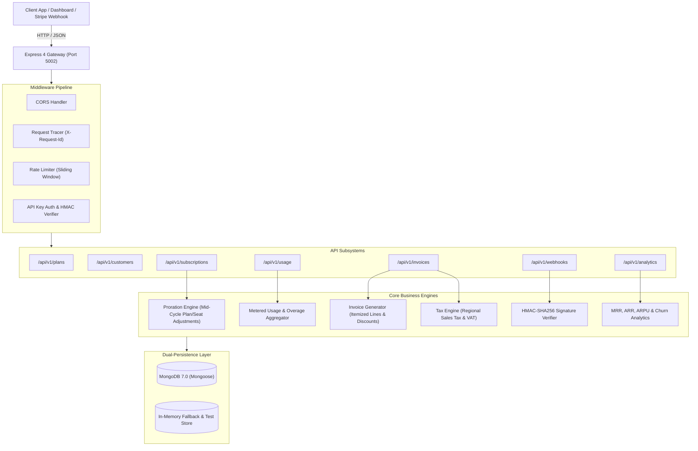

# BillFlow API 💳⚡

> High-throughput SaaS subscription billing, metered usage tracking, proration, and invoice generation engine built on the MERN stack (Node.js, Express, MongoDB).

[](https://github.com/Jeevan-a10/billflow-api/actions/workflows/ci.yml)
[](https://billflow-api-bsxr.onrender.com/health)
[](https://nodejs.org/)
[](https://opensource.org/licenses/MIT)
[](tests/)

🌐 **Live Production API**: [`https://billflow-api-bsxr.onrender.com`](https://billflow-api-bsxr.onrender.com)  
🩺 **Health Endpoint**: [`https://billflow-api-bsxr.onrender.com/health`](https://billflow-api-bsxr.onrender.com/health)

---

## 🏗️ System Architecture



---

## ⚡ Core Features

1. **Flexible Subscription Lifecycles**:
   - Manage monthly and yearly billing intervals.
   - Automated seat-based pricing multipliers.
   - Statuses: `trialing`, `active`, `past_due`, `paused`, `canceled`.
   - Supports both immediate cancellation and soft `cancelAtPeriodEnd` termination.

2. **Precise Mid-Cycle Proration Engine**:
   - Upgrading plans or adding seats mid-cycle automatically credits unused days and charges only the prorated remainder of the period.
   - Provides a preview endpoint (`previewOnly: true`) for instant client-side checkout quotes.

3. **Metered Usage & Overage Billing**:
   - High-throughput ingestion of meter events (API calls, storage GB, compute minutes).
   - Real-time comparison against plan included allowances.
   - Automatic tiered overage computation.

4. **Automated Invoicing & Regional Taxation**:
   - Automatic generation of the initial invoice upon subscription creation.
   - Multi-item support: base subscription, seat increments, prorations, overages, and discounts.
   - Jurisdiction-aware tax calculations (US State tax, UK/EU VAT, India GST).
   - Lifecycle management: `draft` ➔ `open` ➔ `paid` ➔ `void`.

5. **Cryptographic Webhook Ingestion & Idempotency**:
   - Stripe-compatible webhook receiver with HMAC-SHA256 signature verification (`x-signature`).
   - Idempotent replay protection preventing duplicate event side-effects.
   - Built-in event simulation helper for rapid testing.

6. **Real-Time SaaS Revenue Analytics**:
   - Instant calculation of **MRR** (Monthly Recurring Revenue) with yearly interval normalization.
   - **ARR** (Annual Run Rate), **ARPU** (Average Revenue Per User), and **LTV** (Customer Lifetime Value).
   - 30-day cohort **Churn Rate** and plan breakdown metrics.

7. **Zero-Flake Dual Persistence Mode**:
   - Connects to MongoDB in production or Docker Compose.
   - Automatically and gracefully falls back to an ultra-fast in-memory store in dev/test, enabling full test suite execution in under 400ms without requiring an external database.

---

## 📡 API Endpoint Reference

| Method | Endpoint | Description |
|---|---|---|
| `GET` | `/health` | Health check & database connection status |
| `GET` | `/api/v1/plans` | List active subscription plans |
| `GET` | `/api/v1/plans/:code` | Retrieve plan details by code |
| `POST` | `/api/v1/plans` | Create a new custom subscription plan |
| `GET` | `/api/v1/customers` | List all customer profiles |
| `GET` | `/api/v1/customers/:id` | Get customer by ID |
| `POST` | `/api/v1/customers` | Register customer account |
| `POST` | `/api/v1/customers/:id/balance` | Adjust customer balance or promotional credits |
| `GET` | `/api/v1/subscriptions` | List subscriptions (filter by `customerId`, `status`) |
| `GET` | `/api/v1/subscriptions/:id` | Retrieve subscription details |
| `POST` | `/api/v1/subscriptions` | Create subscription & auto-generate first invoice |
| `POST` | `/api/v1/subscriptions/:id/upgrade` | Upgrade plan/seats with proration preview or execution |
| `POST` | `/api/v1/subscriptions/:id/cancel` | Cancel subscription (immediate or at period end) |
| `POST` | `/api/v1/usage` | Ingest metered usage event with idempotency key |
| `GET` | `/api/v1/usage/customer/:customerId`| Aggregate customer usage & calculate overage fees |
| `GET` | `/api/v1/invoices` | List invoices (filter by `customerId`, `status`) |
| `GET` | `/api/v1/invoices/:id` | Get invoice details and line items |
| `POST` | `/api/v1/invoices` | Create manual invoice |
| `POST` | `/api/v1/invoices/:id/pay` | Mark invoice paid |
| `POST` | `/api/v1/invoices/:id/void` | Mark invoice void |
| `POST` | `/api/v1/webhooks/receive` | Ingest external payment webhook with HMAC signature |
| `GET` | `/api/v1/webhooks/events` | Audit log of received webhook events |
| `POST` | `/api/v1/webhooks/simulate` | Generate mock webhook payload and valid HMAC signature |
| `GET` | `/api/v1/analytics/overview` | Real-time MRR, ARR, ARPU, Churn, and distribution stats |

---

## 🧪 Automated Testing

Runs on native Node.js test runner with zero dependencies:

```bash
npm test
```

```text
✔ SaaS Metrics & Analytics Suite
✔ Customers API Suite
✔ BillFlow Health Check Suite
✔ Invoicing & Tax Engine Suite
✔ Middleware Suite
✔ Plans API Suite
✔ Subscriptions & Proration Engine Suite
✔ Metered Usage & Overage Billing Suite
✔ Webhooks & Cryptographic Signature Suite

ℹ tests 36
ℹ pass 36
ℹ fail 0
ℹ duration_ms ~360ms
```

---

## 🐳 Docker & Local Development

### Run via Docker Compose

```bash
docker compose up -d billflow-api
```

### Standalone Docker Build

```bash
docker build -t billflow-api .
docker run -p 5002:5002 --env-file .env billflow-api
```

---

## 📜 License

MIT © [Jeevan](https://github.com/Jeevan-a10)
